<h1 align="center">
  
</h1>


---

## Table of Contents

- [Student Information](#student-information)
- [Repository Structure](#repository-structure)
- [List of Experiments](#list-of-experiments)
- [Quick Links](#quick-links)
- [Technologies Used](#technologies-used)
- [Screenshots](#screenshots)
- [Learning Outcomes](#learning-outcomes)
- [How to Run](#how-to-run)
- [License](#license)

---

## Student Information

| Field | Details |
|---|---|
| **Name** | Ananya Marghade |
| **PRN** | 24070521004 |
| **Batch** | A1 |
| **Course** | B.Tech — Computer Science and Engineering |
| **Institute** | Symbiosis Institute of Technology, Nagpur |

## Repository Structure

```
JavaScript-Lab/
│
├── 01 Department & Student Page/
│   ├── department.html
│   ├── student.html
│   ├── script.js
│   └── style.css
│
├── 02 Billing Calculator/
│   ├── shop-billing.html
│   └── shop-billing.js
│
├── 03 Student Login & grading/
│   ├── 3.1) Student Grading System/
│   │   └── studentgrading.html
│   └── 3.2) Student Login Page/
│       ├── index.html
│       ├── script.js
│       └── style.css
│
├── 04 Try-catch/
│   ├── 4.1) Palindrome Checker/
│   │   ├── palindrome.html
│   │   └── palindrome.js
│   └── 4.2) Vehicle Registration Page/
│       ├── vehicleregistration.html
│       └── vehicleregistration.js
│
├── 05 Cart Calculator & Expense Tracker/
│   ├── 5.1 Cart Calculator/
│   │   └── exp5.html
│   └── 5.2 Expense Tracker (Array MIn Max)/
│       ├── expense.html
│       ├── expense.css
│       └── expense.js
│
├── 06 Use string functions and regex  for validation/
│   ├── exp6.html
│   ├── exp6 case study.html
│   └── feedback form.html
│
├── 07 Perform DOM traversal and updates/
│   ├── todo.html
│   ├── form.html
│   └── welcome.html
│
├── 08 Access and validate form fields using events/
│   ├── exp8.html
│   └── exp8casestudy.html
│
├── 09 Implement localStorage and sessionStorage/
│   ├── themechange.html
│   └── seminar planner case study.html
│
└── 10 JSON Data with Fetch and jQuery/
    ├── 10.1) Using Fetch()/
    │   ├── exp10.1.html
    │   └── exp10casestudy.html
    └── 10.2) Using jquery/
        ├── exp10.2.html
        └── exp10part2casestudy.html
```

Each experiment folder includes:
- Source code (`.html` / `.css` / `.js`)
- A working, styled UI — not a bare-bones demo
- Output screenshots
- A paired case study applying the same concept in a second program

---

## List of Experiments

| # | Title | Experiment | Case Study |
|---|---|---|---|
| 1 | Inline, Internal & External JavaScript, Console Methods | Department landing page — inline event handler + external script | Student Information Portal — internal script, form validation, `console.table` |
| 2 | `var`, `let`, `const`, Template Literals, Destructuring | QuickCart Billing Calculator — cart, GST, discounts, printable receipt | — |
| 3 | Control Structures & Form Validation | Student Grading System — marks → grade → report card | Student Login Page — real-time field validation |
| 4 | Function Types, Scope, Closures, try-catch | Palindrome Checker — closures + exception handling | Vehicle Registration Number Validator |
| 5 | Arrays, Array Methods, Math.max/min | CartEase — cart total calculator with slab-based discount logic | Pennywise — Expense Tracker (array min/max, total, average) |
| 6 | String Functions & Regular Expressions | String Methods & Regex demo — split, match, replace, indexOf, email validation/extraction, reverse | String Operations (reverse + vowel count) & Feedback Analyzer |
| 7 | DOM Traversal & Updates | To-Do List (createElement, appendChild, classList, querySelectorAll) | Sign Up Form (dynamic dropdowns + live validation) & Welcome Page |
| 8 | Accessing & Validating Form Fields Using Events | Gym Admission Form — focus/blur/change validation with regex | BearGYM Admission Form — live BMI, dynamic pricing, full submit validation |
| 9 | `localStorage` & `sessionStorage` | Theme Preference — light/dark theme saved, restored on reload and clearable | Seminar Schedule Planner — preferences saved as JSON in `localStorage`, session selections in `sessionStorage`, schedule re-rendered on load |
| 10 | Loading JSON Data with `fetch()` & jQuery | Student Details — `fetch()` + `.then()` chain, `response.json()`, table built from a JSON file; same table again with `$.getJSON()` and `$.each()` | Employee Information Management (`fetch()` + `localStorage` + File System Access API) & OrderDesk Restaurant Dashboard (`$.getJSON()`, `.done()` / `.fail()` / `.always()`, status totals and sales summary) |

---

## Quick Links

| Experiment | Lab Record | Source Folder |
|---|---|---|
| 1 | [Experiment1.md](<./01 Department & Student Page/README.md>) | [`01 Department & Student Page/`](<./01 Department & Student Page>) |
| 2 | [Experiment2.md](<./02 Billing Calculator/README.md>) | [`02 Billing Calculator/`](<./02 Billing Calculator>) |
| 3 | [Experiment3.md](<./03 Student Login & grading/README.md>) | [`03 Student Login & grading/`](<./03 Student Login & grading>) |
| 4 | [Experiment4.md](<./04 Try-catch/README.md>) | [`04 Try-catch/`](<./04 Try-catch>) |
| 5 | [Experiment5.md](<./05 Cart Calculator & Expense Tracker/README.md>) | [`05 Cart Calculator & Expense Tracker/`](<./05 Cart Calculator & Expense Tracker>) |
| 6 | [Experiment6.md](<./06 Use string functions and regex  for validation/README.md>) | [`06 Use string functions and regex  for validation/`](<./06 Use string functions and regex  for validation>) |
| 7 | [Experiment7.md](<./07 Perform DOM traversal and updates/README.md>) | [`07 Perform DOM traversal and updates/`](<./07 Perform DOM traversal and updates>) |
| 8 | [Experiment8.md](<./08 Access and validate form fields using events/README.md>) | [`08 Access and validate form fields using events/`](<./08 Access and validate form fields using events>) |
| 9 | [Experiment9.md](<./09 Implement localStorage and sessionStorage/README.md>) | [`09 Implement localStorage and sessionStorage/`](<./09 Implement localStorage and sessionStorage>) |
| 10 | [Experiment10.md](<./10 JSON Data with Fetch and jQuery/README.md>) | [`10 JSON Data with Fetch and jQuery/`](<./10 JSON Data with Fetch and jQuery>) |

---

## Technologies Used

- HTML5
- CSS3
- JavaScript (ES6+)
- jQuery 3.7.1 (CDN)
- Visual Studio Code
- Google Chrome
- VS Code Live Server
- Git & GitHub
  
---

## Screenshots

<p align="center">
  <b>Experiment 1 — Student Information Portal</b><br>
  <br><br>
  <b>Experiment 2 — Billing Calculator</b><br>
  <br><br>
  <b>Experiment 3 — Student Grading System</b><br>
  <br><br>
  <b>Experiment 4 — Palindrome Checker</b><br>
  <br><br>
  <b>Experiment 5 — CartEase Billing Calculator</b><br>
  <br><br>
  <b>Experiment 6 — Feedback Analyzer</b><br>
  <br><br>
  <b>Experiment 7 — SignUp Form</b><br>
  <br><br>
  <b>Experiment 8 — BearGYM Admission Form</b><br>
  <br><br>
  <b>Experiment 9 — Seminar Schedule Planner</b><br>
  <br><br>
  <b>Experiment 10 — OrderDesk Restaurant Order Dashboard</b><br>
  
</p>

---

## Learning Outcomes

Through these practicals, the following JavaScript concepts were implemented hands-on:

- Variable declarations (`var`, `let`, `const`) and scope
- Control structures (`if-else`, nested conditionals)
- Functions, closures, and higher-order functions
- Template literals
- `try-catch` exception handling
- DOM manipulation and dynamic rendering
- Event handling (inline, internal, external)
- Real-time form validation with regex
- Persisting data in the browser with `localStorage` and `sessionStorage` (`setItem`, `getItem`, `removeItem`)
- Serialising arrays and objects with `JSON.stringify()` / `JSON.parse()` for storage
- Loading external JSON data asynchronously with `fetch()` — promise chaining (`.then()` / `.catch()`) and `response.json()`
- Fetching and rendering JSON with jQuery — `$.getJSON()`, `$.each()`, `.append()`, `.done()` / `.fail()` / `.always()`
- Running pages through a local server (VS Code Live Server) so `fetch()` and AJAX requests work
- Console methods (`log`, `warn`, `error`, `table`) for debugging
- Building complete, styled, interactive mini-applications — not isolated code snippets

---

## How to Run

1. **Clone the repository**
   ```bash
   git clone https://github.com/ananyamarghade/JavaScript-Lab.git
   ```
2. **Open any experiment folder** and launch its main `.html` file (e.g. `index.html`, `department.html`, `shop-billing.html`) directly in a browser.
3. No build tools, servers, or dependencies required — everything runs client-side.

---

## License

This repository is created for educational and academic purposes as part of coursework at Symbiosis Institute of Technology, Nagpur.

---

<div align="center">

**Ananya Marghade**
B.Tech Computer Science and Engineering · Symbiosis Institute of Technology, Nagpur

</div>
